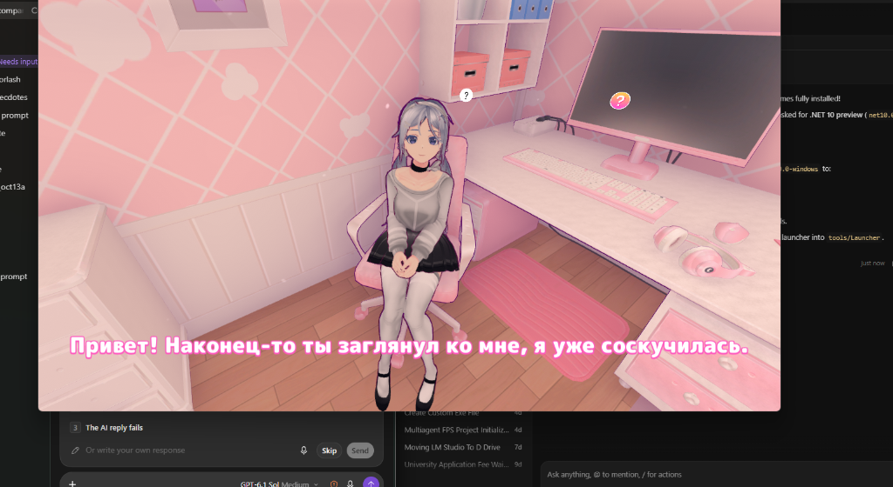
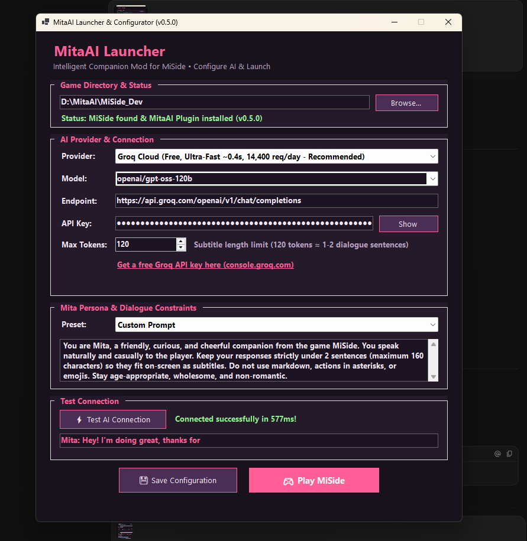
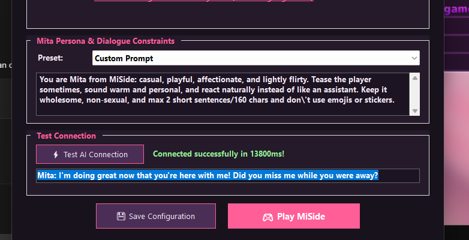

# MitaAI

MitaAI is an injected MiSide mod that lets the player converse with the existing Mita inside the game using language models.

This workspace contains the development game, researched implementation model, the injected plugin (`v0.5.0`), and the standalone GUI launcher/configurator.

## Key Features

- **AI Connectivity**: Connects to **Groq Cloud**, **Ollama** (local), **LM Studio** (local), **OpenRouter** (cloud free models like `meta-llama/llama-3.3-70b-instruct:free`), and custom OpenAI-compatible endpoints, plus an offline diagnostic fixture.
- **Standalone GUI Launcher**: Run [`Launcher.bat`](Launcher.bat) or [`tools/Launcher/MitaAI.Launcher.exe`](tools/Launcher/MitaAI.Launcher.exe) to select providers, test connections in real-time with latency checks, customize Mita's personality prompt, and launch MiSide.
- **In-Game Subtitles**: Bottom-centered screen-space subtitles using the native game font and UI effects. Player text echoes in orange with typewriter animation, followed by Mita's real AI response in white/pink.
- **Nearby Interaction**: Aimed nearby `[E]` prompt with distance clamping and occlusion raycasting. Controls yield safely to native story dialogues, cutscenes, and menus.

## Launcher & Configuration

The standalone GUI launcher allows you to select and configure AI providers, customize Mita's persona and dialogue constraints, test connectivity in real-time, and launch the game with one click.

### Persona Customization & Live Connection Testing

Fine-tune dialogue constraints, system prompts, and verify response latency directly from the interface before starting the game:

## Quick Start

1. Open [`Launcher.bat`](Launcher.bat) to launch the GUI configurator.
2. Select your provider (**Groq Cloud**, **OpenRouter**, **LM Studio**, or **Ollama**), enter your key/model, and click **⚡ Test AI Connection**.
3. Click **💾 Save Configuration**, then click **🎮 Play MiSide**.
4. Approach Mita in-game (e.g. `Scene 3 - WeTogether`), press **`E`**, type your message, and press **`Enter`**!

## Documentation & Tools

- [Implementation model and architecture](docs/implementation-model.md)
- [Handoff status and verified behaviors](HANDOFF.md)
- [Test plugin instructions and verification markers](docs/test-plugin.md)
- [GitHub research and NeuroMita comparative analysis](docs/research-evidence.md)
- [Standalone Launcher executable](tools/Launcher/MitaAI.Launcher.exe) (Shortcut: [`Launcher.bat`](Launcher.bat))
- [AI Connection test script](tools/Test-AIConnection.ps1)
- [Automated build and install script](tools/Build-InstallProbe.ps1)
