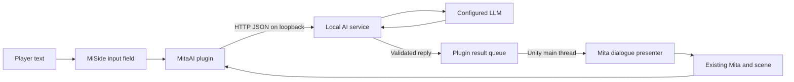

# MitaAI Implementation Model

Research date: 5-6 October 2026. Target: `D:\MitaAI\MiSide_Dev`.

Current voice update (9 October): the bounded coexistence test completed on 8 October with two successful overlapping local AI requests and GPU TTS while MiSide remained running. Warm voice latency was 6.09 seconds with LLM resident idle and 7.93-7.97 seconds during active requests; sampled aggregate RTX peak 4468 MiB. Audio hashes match prior auditions and 28 focused checks pass. Game FPS was not measured; smoothness feedback, acceptable full-turn latency and integration approval remain pending. TTS is not integrated. This supersedes the concurrent-testing-pending statement in the earlier note below. Evidence: `reports/voice-coexistence-2026-10-08.md`.

Current-stage note (8 October 2026): the game baseline is v0.5.2 with live AI text, nearby E interaction and H session history. Standalone voice evaluation is isolated under `local/voice` on D:. Nano English is an accepted fallback; Chatterbox Multilingual auditions were rejected. The second CPU F5 Russian v2 sample is provisionally accepted for sound, and the GPU curious preview received explicit sound approval on 8 October. GPU support and a 32-step standalone benchmark completed on 7 October: warm generation 3.11-3.47 seconds per short line, versus roughly 125 seconds on CPU. CUDA and saved artifacts were reverified after shutdown on 8 October, with 23 standalone checks passing. Concurrent game/LLM testing and integration approval remain pending; TTS is not integrated in-game. See the newest `HANDOFF.md` entry and `reports/voice-gpu-evaluation-2026-10-08.md`. Installer/hardware profiles are later proposals, not implemented work. Presentation uses a mod-owned screen Canvas with native fonts/effects, not native story-dialogue execution. The earlier implementation updates and proposed architecture below are historical; do not interpret pending claims below as the current release status.

Latest work: version 0.5.0 implements unified OpenAI-compatible AI connectivity (Ollama, LM Studio, OpenRouter free models, and Custom endpoints) directly within the plugin's async pipeline, accompanied by a standalone Windows GUI Launcher & Configurator (`tools/Launcher/MitaAI.Launcher.exe`). Subtitles use isolated bottom-centered screen text reusing native font and UI effects. The async background request prevents any Unity thread freezing. 243 managed checks pass. See `HANDOFF.md`, `README.md`, and `docs/test-plugin.md` for verification details.

Implementation update: the first fixed caption was confirmed in `Scene 4 - StartSecret`. Version 0.2.0's standard IMGUI field failed because `GUIStateObjects.GetStateObject` is stripped; 0.2.1's native keyboard alternative then failed seated-target detection and closed immediately on an observed input-state change. Installed 0.2.2 uses projected model bounds and a bounded suspension of the verified player controller, leaving story input flags untouched. It builds cleanly and passes 128 managed composer/visibility/lease checks, but G2 requires actual gameplay verification. See [test instructions](test-plugin.md), [earlier startup evidence](../reports/probe-startup-2026-10-05.json), and `HANDOFF.md`. Native dialogue and the AI connection remain pending. The research observations below include the pre-installation baseline.

## Decision

Use a small C# BepInEx 6 IL2CPP plugin inside MiSide, backed by a separate local AI service. Begin with the MiSide community's documented `6.0.0-pre.2` Windows x64 IL2CPP package. The existing game supplies Mita, its scenes, camera, and presentation resources. The plugin handles input, binding to scene objects, and presenting replies. The local service handles the model request.

This route has both source precedent and matching local metadata. At research time, the loader and injected probe had not been installed or run. The implementation update above records current startup evidence. Proceed through the remaining runtime gates below before committing to the larger mod. [KappiMod loader](https://github.com/MrSago/MiSide-KappiMod/blob/f01a0763e18a6b8337cc4a831cadbed173c73c35/Loader/BepInEx/KappiBepInExPlugin.cs), [MiSide loader instructions](https://github.com/MrSago/MiSide-KappiMod/blob/f01a0763e18a6b8337cc4a831cadbed173c73c35/README.md).

## What Was Verified Locally

These observations are reproduced by [the preflight report](../reports/environment-2026-10-05.json). They describe this copy, rather than every current MiSide release.

| Check | Observed result | Implementation consequence |
| --- | --- | --- |
| Game version label | `VERSION 0.923` in `Data/Version.txt` | Pin the initial supported build to its file fingerprints. |
| Unity version | `2021.3.35f1` from `UnityPlayer.dll` | Use matching Unity base libraries for interop generation. |
| Executable architecture | Executable, UnityPlayer, and GameAssembly are x64 | Use the Windows x64 IL2CPP loader package. |
| Scripting backend | `GameAssembly.dll` and standard metadata version 29 | Generate callable IL2CPP interop assemblies. |
| Metadata structure | 6,262 type records; relevant fields and methods belong to the expected types | Candidate hooks are present in this build. |
| Dialogue | `Dialogue_3DText` has `textPrint`, `speaker`, `timeShow`, `indexString`, `nextText`, and completion events | A native dialogue adapter has concrete members to probe. |
| Mita | `MitaPerson` has navigation, animator, and look-related members | Identify the existing character now; probe actions in a later stage. |
| Player | `PlayerMove` has `dontMove`, `stopMouseMove`, and `blockInteractive` | Probe bounded input ownership while typing. |
| Future voice | `Dialogue_3DText.LoadVoice` exists with one parameter | A candidate voice integration point exists; audio playback remains untested. |
| Development tools | .NET SDKs 6.0.428 and 10.0.401 are installed | The proposed plugin and service can use the installed toolchain. |
| Loader state | No BepInEx core, game interop, MelonLoader directory, or winhttp proxy | Loader installation and first interop generation are the next prerequisite. |
| Downloads | Official loader ZIP and normalized Unity library ZIP returned HTTP 200 | They are reachable from this machine; contents and loading still need validation. |

The probe parses metadata tables, including method ownership. It does not infer members from an arbitrary binary string search. The record layouts were checked against [Il2CppDumper's metadata definitions](https://github.com/Perfare/Il2CppDumper/blob/4741d46ba9cd6159c5d853eb9d6fc48b4bfa2b1a/Il2CppDumper/Il2Cpp/MetadataClass.cs). It reads version 29 only and fails explicitly on another version.

## First Release

One supported scene containing an existing Mita is sufficient for the first proof. Choose a stable, reachable scene from the player's game state and record its actual name and object bindings during G1. Broader chapter support follows after the first scene passes.

The complete first-release loop is:

1. Launch the actual game and enter the supported scene.
2. Open a small input field with a configurable key, initially F8.
3. Submit a short message and restore normal player input immediately.
4. Send one asynchronous request through the local service to the configured LLM.
5. Display the reply as dialogue associated with the existing Mita.
6. Continue ordinary gameplay and repeat.

There is one input field, a discreet pending/error indicator, and Mita's reply. Stage 1 has no chat transcript window, voice, saved memory, movement commands, autonomous speech, or game progression changes. It may use a short static character instruction to label replies as Mita; the personality definition and conversation history are Stage 2.

The deterministic response used in G1-G3 is a development fixture. It proves plumbing and is never reported as an AI-generated reply. In the corrected 0.2.2 gameplay test, the user confirmed typing hello, receiving this fixture, and moving afterward. Later reopening failed after a logged pause/control takeover left the cursor unlocked. Installed 0.2.3 adds guarded same-player deferred cursor recovery, with 139 managed checks passing. In-game recovery and the broader G2 gate remain incomplete. See [initial gameplay evidence](../reports/text-input-detection-2026-10-05.json) and `HANDOFF.md` for follow-up status.

## Architecture



Use these concrete boundaries:

| Component | Initial responsibilities |
| --- | --- |
| `MitaAI.Plugin` | BepInEx entry point, scene binding, small input field, request lifecycle, result queue, dialogue presentation. |
| `MitaAI.Bridge` | Loopback HTTP endpoints, configuration, provider authentication, model call, response validation, timeout handling. |
| `MitaAI.Contracts` | Small plain-data request/response definitions shared by both components. |

Target the plugin at `net6.0` to match the chosen loader runtime. Target the independent service at `net10.0` using the installed SDK; use ASP.NET Core's HTTP hosting and `System.Text.Json`. A shared contracts library can target `netstandard2.0`. Reference BepInEx and the game's generated `BepInEx/interop` assemblies from configurable local paths. Keep those references out of the distributed plugin package. [Community project target](https://github.com/MrSago/MiSide-KappiMod/blob/f01a0763e18a6b8337cc4a831cadbed173c73c35/KappiMod.csproj), [BepInEx first-run setup](https://docs.bepinex.dev/master/articles/dev_guide/plugin_tutorial/1_setup.html).

Build only these projects and their actual first-release helpers. Add memory, audio, and action modules when their stages begin.

## Game Integration

### Loader And Interop

Use the official pinned package, record its downloaded SHA-256, and retain a manifest of added loader files. The GitHub release API currently supplies no asset digest for this older release; a locally recorded hash identifies the downloaded copy but does not independently authenticate it. Run the game once to generate interop and confirm `Assembly-CSharp.dll` exists. Compile against that generated assembly and the matching loader core.

The plugin entry point derives from `BepInEx.Unity.IL2CPP.BasePlugin`. Register a uniquely named Unity behaviour through the pinned loader's component API, following the pattern used by MiSide's console unlocker. Confirm the API and required constructor against the installed loader before compiling. That behaviour owns `Update`, input, and the main-thread queue. [Console unlocker entry point](https://github.com/Rist8/MiSide-Console-Unlocker/blob/13db883ae17f58b4c17db20cfb6e4fbae45de59b/Plugin/PluginLoader.cs).

### Scene And Character Binding

Enumerate loaded scene objects on scene load and, during delayed initialization, retry at a bounded frequency. Filter out asset prefabs and unloaded scenes. Resolve Mita through `MitaPerson`, then verify which visible model object the native dialogue expects as its speaker. Resolve `PlayerMove` for input handling. Cache the result and invalidate it on scene unload, destroyed objects, or character replacement.

Record the chosen Mita instance and dialogue-template path. If multiple Mitas are present, require an explicit binding for the initial supported scene. A successful match to the name "Mita" alone is insufficient. Existing multiplayer code demonstrates loaded-scene filtering and cached component discovery. [Mita scene cache](https://github.com/QuestionBlock64/MiSide-Multiplayer/blob/efc1c28f2c85d3dbe7498feeef942e487d6f7eb2/Runtime/Mita/MitaSceneCache.cs).

### Native Dialogue Presenter

NeuroMita's archived injected integration creates a dialogue from an existing scene template and fills text, speaker, and duration. It also overrides the localization index and removes the link to the next dialogue. This is the primary presentation precedent. Its template paths are scene-specific and need probing against this local copy. [Archived dialogue implementation](https://github.com/VinerX/NeuroMita/blob/bff1361660c2d18eace4b7ac0af2d76072b59d97/archive/legacy_mitaai_csharp/MitaAI/ConnectionAndDialogue/DialogueControl.cs).

For MitaAI, the adapter must validate an inactive source template and its component list, create its own inactive instance, configure it, and activate only after all checks pass. Verify clone initialization behaviour during G1. Set player-provided reply text, the verified speaker object, and bounded display duration. Validate `indexString = -1` in-game rather than assuming it always bypasses localization.

Detach `nextText` and replace completion events with empty instances of their actual generated types. Inspect persistent callbacks and any additional attached scripts. Remove inherited voice/print audio references and verify `dontVoice` behaviour so the text-only proof plays no inherited clip. Check that text cleanup, localization, subtitle rendering, and disposal cannot advance a quest. Do not alter the original dialogue object or original Mita AI.

Use one native dialogue instance at a time. Wait for ordinary story dialogue to finish, with a bounded wait; expire the generated reply if the scene or target changes. Disable AI presentation during supported-scene cutscenes and menus until coexistence is verified.

If native dialogue cannot be made independent of story callbacks within G1's timebox, use a small world-space caption attached to the verified Mita model, rendered with the game's existing font. This remains character-linked in-game presentation. Record that native dialogue is incomplete; the caption proof does not establish native dialogue integration. Proceed with the minimal caption only if its independent presentation passes G1 and G2.

### Input Ownership

Use a Unity UI input field or an equally small IMGUI field, depending on the proven native font and UI components. Capture cursor lock/visibility and player input flags when opening it. Gate movement, camera look, and interaction only while composing. Restore captured values on submit, Escape, focus loss, disable, and scene unload, subject to ownership changes by the game.

Probe whether the three player flags prevent gameplay hotkeys while typing. Add narrowly scoped input suppression only for demonstrated leakage. Never suspend the Unity thread or globally freeze game time. If a cutscene takes control while the field is open, close the field and release its input ownership without overriding the cutscene's new state. Multiplayer's chat controller provides a working input/cursor precedent; its unconditional movement re-enable should be improved with captured-state restoration. [Chat controller](https://github.com/QuestionBlock64/MiSide-Multiplayer/blob/efc1c28f2c85d3dbe7498feeef942e487d6f7eb2/Runtime/Chat/ChatController.cs).

## AI Service Contract

Bind the service only to `127.0.0.1`, on a configurable port, and use a local pairing token shared with the plugin. Keep model credentials in the service's environment/configuration. Provide `GET /health` and `POST /v1/chat`. Select one provider and model during implementation; keep its provider-specific payload inside the service.

The following is a proposed MitaAI contract, rather than a provider API:

```json
{
  "schemaVersion": 1,
  "requestId": "unique-request-id",
  "playSessionId": "unique-launch-id",
  "sceneEpoch": 3,
  "characterId": "bound-mita-instance",
  "message": "What are you doing?"
}
```

```json
{
  "schemaVersion": 1,
  "requestId": "unique-request-id",
  "playSessionId": "unique-launch-id",
  "sceneEpoch": 3,
  "characterId": "bound-mita-instance",
  "text": "Looking around. Did you need something?"
}
```

IDs above are illustrative. Actual identifiers are generated locally. Return a separate structured error on failure. Stage 1 returns text only. Use bounded input and output lengths, initially 1,000 and 600 characters respectively, and a 30-second request deadline. These are initial product limits, to adjust after measurement.

Perform HTTP work asynchronously off the Unity thread. Place completed plain-data results on a bounded queue and consume them in `Update`. The main thread checks every echoed identifier against the current request and scene binding before touching Unity objects. Allow one outstanding player turn. Cancel on scene change, game shutdown, or explicit cancellation. A timeout restores the ready state; it never fabricates a Mita reply. Never execute model text as a command or interpret action tags in Stage 1.

Connection and model delays must leave the game responsive. Log request ID, stage, duration, status, and error category. Keep API keys and conversation text out of normal diagnostic logs. Initial acceptance targets a typical reply within 10 seconds on the selected provider, with the deadline handling slower results. This target is not a measured latency claim.

## Acceptance Gates

Timeboxes below are planning budgets for focused development, not guaranteed completion times. A gate passes only with its listed evidence. Development stops at the stated decision point instead of accumulating later features around an unresolved dependency.

| Gate | Work and required evidence | Initial budget / decision |
| --- | --- | --- |
| Preflight | Parse local binaries and metadata, hash the target files, inspect required members, check downloads. | Passed on 5 October 2026; retain the JSON report. |
| G0: injection | Boot the game with only the loader and tiny probe; produce plugin and main-thread heartbeat logs, generated interop, and successful menu/game entry. Repeat across three launches. | Up to 2 hours total. Try BepInEx first; permit one isolated MelonLoader attempt if loader failure remains. Reconsider injection if neither passes. |
| G1: Mita presentation | In one recorded scene, identify real Mita and a valid template. Display a fixed diagnostic line associated with Mita. Capture screenshot/video and log chosen object IDs. Confirm no inherited audio, callbacks, quest progression, or displaced story dialogue. | Up to 2 hours. Decide native dialogue versus the character-linked caption. Stop if neither safely presents a line. |
| G2: text input | Compose and submit 20 short turns, cancel with Escape, reopen, change focus, and unload/reload the scene. Verify text, cursor, camera, interaction, and movement restoration, including opening while movement is already blocked. | About 1-2 hours. Correct demonstrated input leakage before adding network calls. |
| G3: local transport | Send fixture responses through the local service. Simulate service absent, delayed/malformed reply, wrong IDs, and scene change while pending. Verify no freeze, duplicate request, stale speaker, or stuck pending state. | About 1-2 hours. Keep the fixture available for later troubleshooting. |
| G4: real AI | Configure one real provider and complete at least 10 live turns. Capture metadata-only timing logs and in-game evidence. A development-only HTTP trace can record a redacted endpoint/status and a reply digest to establish provider provenance. Verify offline/authentication/rate-limit errors return input to ready. | About 1-2 hours once a provider is available. Stage 1 passes only here. |
| G5: coexistence | Run at least 30 minutes in the supported scene and adjacent transition. Exercise ordinary story dialogue and a progression checkpoint with the mod enabled. Compare with a baseline on the same build. Disable the plugin using its recorded install manifest and confirm ordinary play still works. | Complete before calling Stage 1 ready for use. |

G0-G2 are the first implementation task and determine whether the chosen integration is workable quickly. The larger roadmap remains contingent on them. A runtime failure should include the exact build hashes, loader version, log, and failing gate.

Keep protocol and lifecycle tests focused on invalid IDs, timeouts, cancellation, and scene changes. Unity object lifecycle and story progression require actual in-game verification; successful compilation and service tests do not cover them.

## Known Technical Failure Paths

| Failure | Evidence / preventive choice | Response if observed |
| --- | --- | --- |
| Unity libraries cannot download | A MiSide loader issue reports this failure. The pinned pre.2 source normalizes Unity version to major/minor/build. The reachable local URL is `2021.3.35.zip`; the `2021.3.35f1.zip` URL returned 404. | Inspect the requested URL and transport error. Use the normalized official URL through `UnityBaseLibrariesSource` if needed. Inspect the pinned download routine before manually populating the cache: it clears existing DLLs. |
| Plugin compiles against incompatible game types | Local metadata matches the expected names; game interop has not yet been generated. | Build against this copy's generated interop, pin loader dependencies, and repeat the gate after updates. |
| Quest changes when AI text ends | Native dialogue contains successor and completion members; KappiMod documents softlock risk from dialogue manipulation. | Sanitize owned dialogue and validate story coexistence. Use the caption option if the native component remains coupled to progression. |
| Typing moves the player or leaves controls blocked | Existing multiplayer chat demonstrates cursor/movement handling. | Capture and restore actual ownership state; verify all close paths and demonstrated interaction leakage. |
| Reply addresses a deleted or different Mita | Existing mods refresh bindings across scenes. | Cancel requests and invalidate templates on scene/character changes; reject late results by session, epoch, request, and target. |
| Network request stalls the game | Archived AI integration demonstrates a loopback boundary, but its raw TCP framing is limited. | Use complete HTTP JSON messages, deadlines, and a main-thread result queue; keep synchronous waits out of Unity callbacks. |

These responses come from [BepInEx issue #1033](https://github.com/BepInEx/BepInEx/issues/1033), [the pinned interop download routine](https://github.com/BepInEx/BepInEx/blob/v6.0.0-pre.2/Runtimes/Unity/BepInEx.Unity.IL2CPP/Il2CppInteropManager.cs), [KappiMod's dialogue notes](https://github.com/MrSago/MiSide-KappiMod/blob/f01a0763e18a6b8337cc4a831cadbed173c73c35/README.md), and [archived loopback networking](https://github.com/VinerX/NeuroMita/blob/bff1361660c2d18eace4b7ac0af2d76072b59d97/archive/legacy_mitaai_csharp/MitaAI/ConnectionAndDialogue/NetworkController.cs). They are mitigation plans, not claims that the local runtime has already passed.

Use one loader per development configuration. If testing MelonLoader, isolate its installation and dependencies from BepInEx through the install manifest or a separate development copy. Loader support in other mods makes it a credible fallback; it does not prove that switching will resolve a particular failure.

## Later Stages

| Stage | Added behaviour | Verification before the next stage |
| --- | --- | --- |
| 2: character conversation | Versioned Mita-specific style, behavioural rules, context handling, and bounded session conversation history in the service. Choose the intended Mita variant explicitly. | Review short multi-turn conversations for consistent style, coherent references, and no invented world observations. No cross-session recall claim. |
| 3: voice | Push-to-talk STT, the same conversation path, then TTS. Audio binds to the verified Mita speaker; subtitles remain available. Begin with a configured original or permitted voice. | Measure each latency segment, verify device errors and text fallback, subtitle/audio alignment, interrupted playback, and echo prevention. |
| 4: game context | Verified scene, player/Mita position, readable animation state, nearby objects, and selected event observations. | Compare every reported fact against the game. Report unknown states explicitly. An animator state alone does not prove a semantic action such as sitting. |
| 4b: bounded actions | One proven action at a time, beginning with a look/turn request. Add navigation and existing animations only after per-scene checks. | A plugin-side allowlist, busy-state gates, range/path checks, cancellation, and story coexistence must pass. Metadata method names alone do not establish callable signatures or safe semantics. |
| 5: persistence and initiative | Local stored conversations and selected player facts, followed by infrequent event-driven initiative with cooldowns. | Verify storage/retrieval/deletion and clear provenance. Autonomy waits for reliable context and action arbitration; no uncontrolled repeated prompts or actions. |

For the character definition, use the game's conversational flavour: concise lines, curiosity, lightly teasing or mysterious responses, and attention to verified game events. Keep the companion experience non-romantic and age-appropriate. Do not write possessive or dependency-seeking behaviour into the persona, invent things she has observed, or let generated text take over game commands. These are product rules for MitaAI, not copied game dialogue.

## Immediate Implementation Deliverable

The next deliverable is a small injected probe and its G0-G2 evidence on this game copy. It needs no paid API, voice models, persistent database, asset replacement, scene reconstruction, or full AI framework. Once it passes, add the local service and one live model to complete the first text-conversation release.
